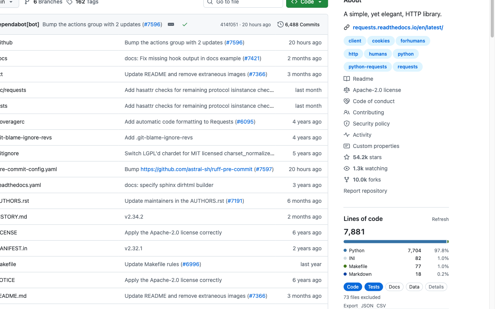

# Codebase Amplified Stats

A Chrome extension that shows **real lines of code per language** on a GitHub repository
page — public or private, any repository you can read.

GitHub's own language bar measures **bytes**, not lines, and counts every file Linguist
recognises. A minified vendor bundle, a generated protobuf or a lock file can dominate the
bar while telling you nothing about the code someone actually wrote. This extension counts
lines, separates code from comments, and throws the machine-written files out first.



## How it works

No backend, no paid service, nothing leaves your browser except requests to GitHub.

```
GET /repos/{owner}/{repo}                     → default branch
GET /repos/{owner}/{repo}/commits/{branch}    → commit SHA (the cache key)
GET /repos/{owner}/{repo}/git/trees/{sha}?recursive=1
        ↓  one request, the entire file listing
   FILTER  vendored / generated / binary / unrecognised / oversized
        ↓  typically removes 60–95% of files
   CACHE   already counted this blob SHA? then skip counting it
        ↓
GET /repos/{owner}/{repo}/tarball/{sha}
        ↓  one gzipped archive, unpacked as it streams
   COUNT   each file's bytes handed to a Web Worker
        ↓  never more than one file in memory at a time
   AGGREGATE per language → rendered into the sidebar
```

Two things make this practical:

**One archive instead of thousands of requests.** A repository costs exactly **four API
requests** no matter how many files it has. The archive endpoint answers with a redirect to
a signed CDN URL, which is also the only documented way to reach a private repository's
contents — so public and private repositories take exactly the same path.

**The cache is keyed by Git blob SHA — a hash of file contents.** A file that has not
changed is never counted twice, across commits, branches, and even forks. The archive is
skipped entirely when every file in a commit has already been counted.

## Accuracy

The counter is a character-level state machine that tracks strings and comments, so
`"// not a comment"` counts as code and a `/* … */` spanning ten lines does not. It handles
nested block comments (Rust, Swift, Haskell), raw strings (Go backticks, Rust `r#"…"#`),
Python docstrings, and CRLF.

Verified per-file against `tokei` and `cloc` on real repositories:

| Language                                                 | vs cloc                |
| -------------------------------------------------------- | ---------------------- |
| TypeScript, JavaScript, YAML, TOML, Ruby, Lua, CSS, HTML | **0.00%**              |
| Go                                                       | +0.4%                  |
| Python                                                   | +1.5%                  |
| Rust                                                     | between cloc and tokei |

Conventions follow `cloc`:

- A line holding both code and a comment counts as **code**.
- Python docstrings count as **comments** (tokei counts them as code).
- Blank lines count as **blank** wherever they appear.

Both reference tools mis-handle `/*` inside Go string literals — `"/src/*filepath"` opens a
block comment for them and swallows the rest of the file. This extension gets that right,
which is why some Go files differ from both.

Languages with no comment syntax in the table are still counted; without those rules every
non-blank line is code, which is the safe direction to be wrong in.

## What gets excluded

Exclusion rules come from [GitHub Linguist](https://github.com/github-linguist/linguist)
itself, plus path rules for generated output:

- **Vendored** — `node_modules/`, `vendor/`, `dist/`, `third_party/`, `.github/`, and 160+ more
- **Generated** — lock files, `*.pb.go`, `*_pb2.py`, `*.min.js`, `__snapshots__/`, `*.designer.cs`
- **Binary** — by extension, plus a NUL-byte check on the bytes themselves
- **Oversized** — above 1 MB by default; these are almost always generated dumps

The panel always reports how many files were excluded and why. A number you cannot explain
is worse than no number.

Everything that survives those rules is counted together: the panel reports one
lines-of-code figure for the repository, broken down by language and nothing else.

## Install

An OAuth App is required — every request the extension makes is authenticated, so a build
without a client ID is useless and `pnpm build` refuses to produce one.

1. Create an OAuth App at <https://github.com/settings/developers> and tick
   **Enable Device Flow**. No callback URL is needed.
2. Build with its Client ID:

```bash
pnpm install
WXT_GITHUB_CLIENT_ID=your_client_id pnpm build     # output in .output/chrome-mv3
```

Load `.output/chrome-mv3` at `chrome://extensions` with developer mode on, open the
extension's options and click **Sign in with GitHub**. The code is copied to your clipboard;
paste it on the page that opens and authorise.

For development with hot reload (this one only warns when the client ID is missing, so the
rest of the extension stays workable):

```bash
WXT_GITHUB_CLIENT_ID=your_client_id pnpm dev
```

### About the token

Device Flow is the only OAuth grant that needs no client secret, which is what makes it
usable from an extension with no backend — the client ID is public by design.

GitHub will ask for the **`repo`** scope, and its consent screen will describe that as full
control of private repositories. That is GitHub's wording, not a description of what this
extension does: `repo` is the only classic OAuth scope that opens private repositories at
all, and GitHub offers no read-only variant. The extension only ever reads — it lists a
repository's files and downloads an archive of them. The token is kept in this browser
profile's extension storage and is sent to GitHub and nowhere else.

## Development

```bash
pnpm compile           # type check — the only automated check there is
pnpm gen:languages     # regenerate language data from Linguist
```

There are no tests at present. That is a deliberate, temporary state: verification is
manual. Take particular care with `src/logic/counter.ts` and `src/logic/tar.ts` — a
regression in either produces numbers that look plausible and are wrong.

### Layout

```
entrypoints/
  github.content/    per-host content script — a shell over src/ui/mount.tsx
  background.ts      orchestrator: resolve → filter → cache → count
  offscreen/         downloads and unpacks the archive; hosts the counting Workers
  options/           settings, sign-in, cache management
src/common/          shared by the engine and every host: RepoRef, errors, the Provider contract
src/logic/           counting engine, filter, tar reader, cache — no DOM, no host specifics
  interfaces/        its shapes: language, filter, stats
src/providers/       GitHub's implementation of the contract, and the registry
src/messaging/       message contracts between the four execution contexts
src/ui/              React components, hooks/, and host-agnostic mounting
scripts/             language-data generator
```

Dependencies run one way. `src/common/` depends on nothing; `logic` and `providers` build on
it and never on each other. Adding a second host means a new `src/providers/<host>/` and a
content-script shell, with the counting engine untouched.

## Known limits

- **Organisation policy.** If an organisation has OAuth App access restrictions enabled, an
  owner has to approve this app before its private repositories are visible; until then they
  look like 404s. Repositories behind SAML SSO need the token authorised for that
  organisation. The panel names both cases when it hits them.
- **A new commit means a fresh download.** Results are cached per commit, and line counts
  are cached per file-content hash — so re-counting is fast — but the archive itself is
  fetched again whenever the commit changes.
- **Very large repositories.** Above 100k files GitHub truncates the tree listing; the panel
  says so and reports a lower bound.
- **YAML block scalars.** A `#` inside a `|` block is counted as a comment. Roughly −2% on
  YAML-heavy repositories.
- **GitHub's markup.** The panel anchors to the Languages block through several fallback
  strategies and re-mounts itself if GitHub re-renders the sidebar. If none match, it mounts
  nothing rather than break the page.

## Privacy

No backend, no telemetry, no third parties: every request goes to GitHub with your own
token, and the caches hold line counts only — never file contents. Full text in
[docs/privacy-policy.md](docs/privacy-policy.md).

## Licence

Language names, colours, vendored-path rules and file-type detection come from
[GitHub Linguist](https://github.com/github-linguist/linguist), used under the MIT licence.
See [NOTICE](NOTICE).
