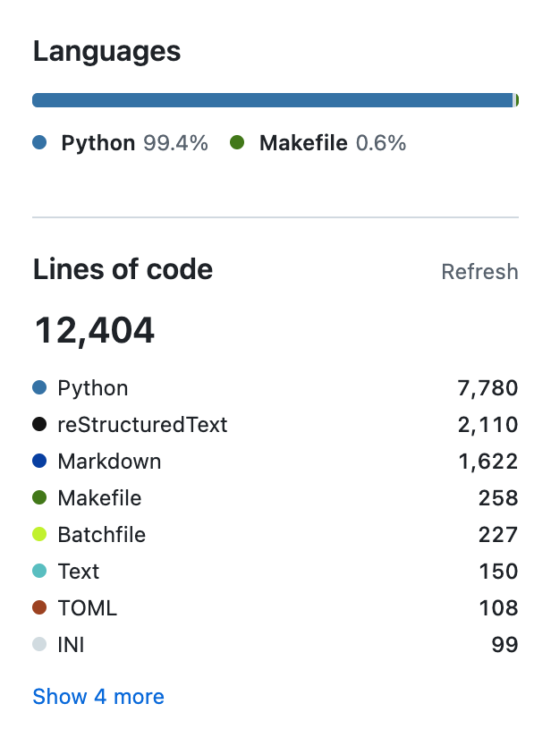
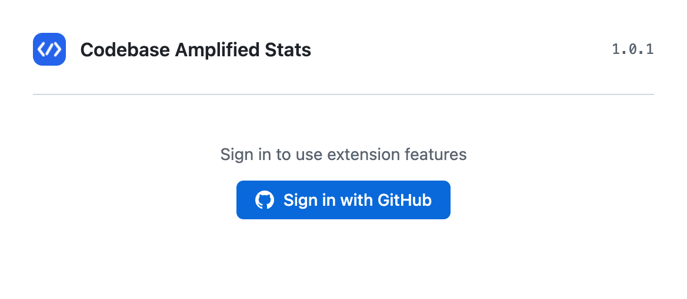
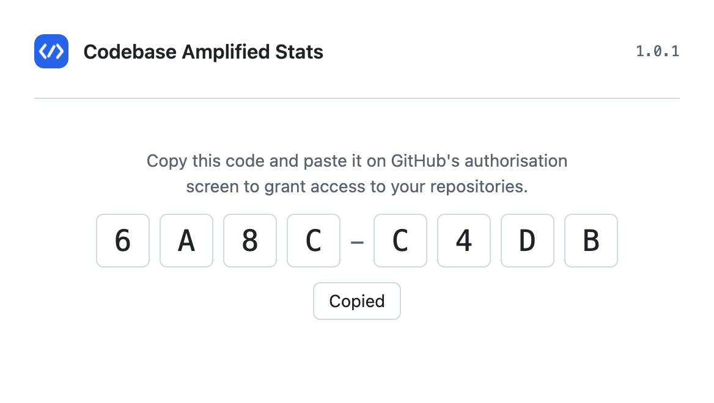
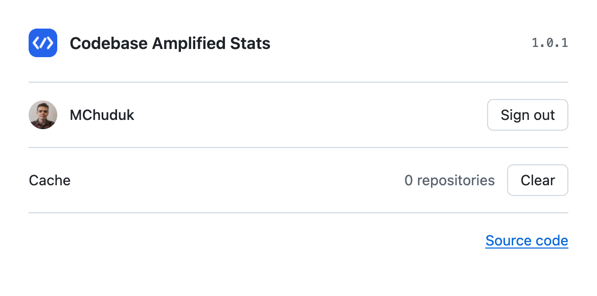

# Codebase Amplified Stats

A Chrome extension that shows **real lines of code per language** on a GitHub repository
page — public or private. GitHub's own bar measures bytes and counts every file Linguist
recognises; this one counts lines and drops vendored, generated and binary files first.



## Sign in

Every request the extension makes is authenticated, so nothing is counted until you sign
in. Sign-in uses GitHub's Device Flow — no password is ever typed into the extension.

**1. Open the extension's options and click _Sign in with GitHub_.**



**2. Paste the code — it is already in your clipboard — on the GitHub tab that opens, and
authorise the app.**



**3. The options page shows your account.** Open any repository: the panel appears under
_Languages_ and counts on its own.



## For developers

A GitHub OAuth App Client ID is required — create one at
<https://github.com/settings/developers> with **Enable Device Flow** ticked (no callback
URL needed) and pass its Client ID as `WXT_GITHUB_CLIENT_ID`. Without it `pnpm build`
refuses to produce a build.

```bash
pnpm install
WXT_GITHUB_CLIENT_ID=<client-id> pnpm dev     # hot reload, Chrome
WXT_GITHUB_CLIENT_ID=<client-id> pnpm build   # → .output/chrome-mv3
pnpm compile                                  # type check
pnpm lint                                     # eslint
pnpm format                                   # prettier
pnpm zip                                      # packaged build for the store
pnpm gen:languages                            # regenerate language data from Linguist
```

## License

[MIT](LICENSE) © Mikhail Chuduk.

Language data is derived from [GitHub Linguist](https://github.com/github-linguist/linguist),
also MIT-licensed — see [NOTICE](NOTICE).
